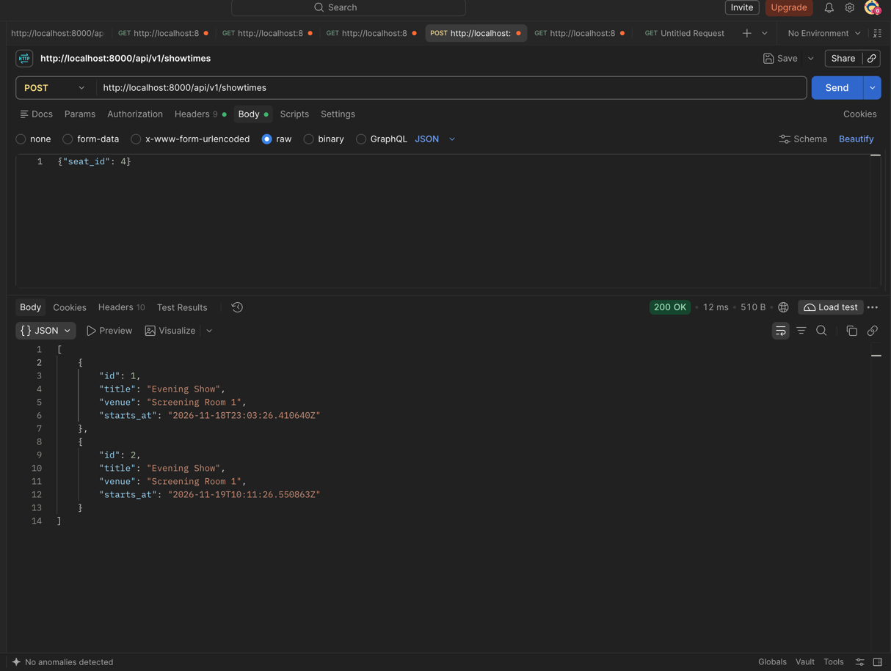
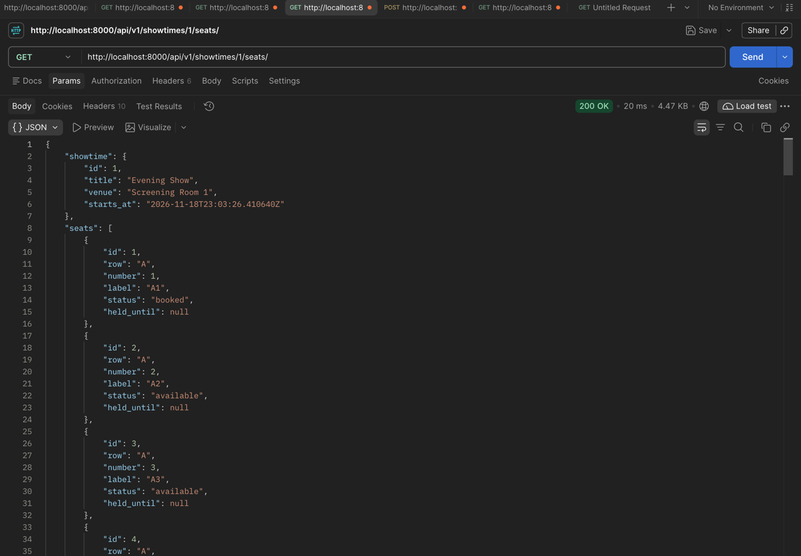
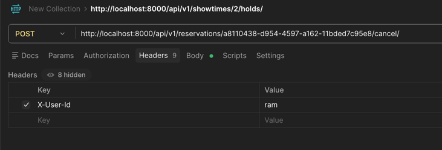
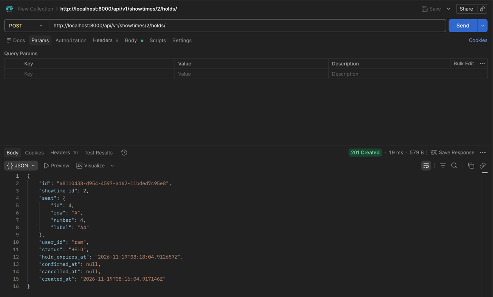
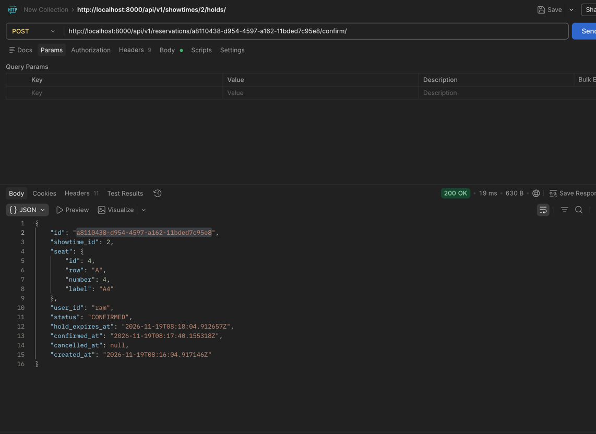
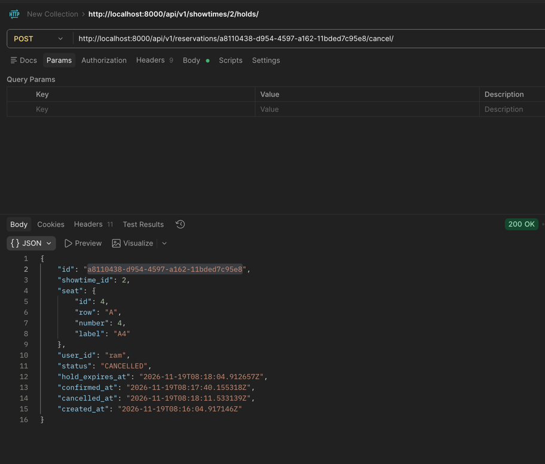

It's built with Django 5.2, Django REST Framework (DRF) and PostgreSQL 16.
- **Proof that concurrent bookings are handled correctly**, with captured output, is in [docs/concurrency_results.md](docs/concurrency_results.md).

---

## Contents

1. [Running locally](#running-locally)
2. [API](#api)
3. [Concurrency safety](#concurrency-safety)
4. [Hold expiry](#hold-expiry)
5. [Idempotency](#idempotency)
6. [Project layout](#project-layout)
7. [How AI tools were used](#how-ai-tools-were-used)
8. [Known limitations / with more time](#known-limitations--with-more-time)
9. [Scaling to thousands of concurrent users](#scaling-to-thousands-of-concurrent-users)

---

## Running locally

### Option A: everything in Docker (recommended)

You need Docker Desktop (or Docker Engine with the Compose plugin) and git.

```bash
git clone <this-repo-url> seat-booking
cd seat-booking
docker compose up --build
```

This brings up four services:

| Service   | What it does |
|-----------|--------------|
| `db`      | PostgreSQL 16, exposed on `localhost:5432` |
| `migrate` | One-off: runs migrations and `seed_demo` (rows A–E × seats 1–10, plus one showtime 3 hours from now) |
| `web`     | The API under gunicorn (4 workers × 4 threads) on `http://localhost:8000` |
| `expirer` | `expire_holds --every 30`, which housekeeps lapsed holds |

Check that it's up:

bash
```bash
curl http://localhost:8000/api/v1/showtimes/
```
postman:
past url in postman



Run the concurrency check. It needs only Python 3.10+ on the host and uses the standard library only:

```bash
python3 scripts/concurrency_check.py -n 20
```

Reset the demo data. This clears all reservations on the demo showtime, or creates a new showtime if the old one has started:

```bash
docker compose run --rm migrate python manage.py seed_demo --reset
```

### Option B: run the app on the host, with Postgres in Docker

You need Python 3.12+ (tested on 3.12 and 3.14) and Docker for Postgres.

```bash
git clone <this-repo-url> seat-booking
cd seat-booking

python3 -m venv .venv
source .venv/bin/activate
pip install -r requirements.txt

docker compose up -d db          # only the database

python manage.py migrate
python manage.py seed_demo       # prints the showtime id

gunicorn config.wsgi -b 127.0.0.1:8000 -w 4 --threads 4
# or, for development: python manage.py runserver
```

The settings defaults match the compose database, so no `.env` is needed. [.env.example](.env.example) lists every variable you can override.

To expire lapsed holds on the host, either from cron or in a terminal:

```bash
python manage.py expire_holds            # one sweep
python manage.py expire_holds --every 30 # keep running
```

> **Why not SQLite?** The booking flow depends on `SELECT ... FOR UPDATE` and partial unique indexes. SQLite has no row-level locks and serialises every write. A concurrency test against it would pass without proving anything.

---

## API

The base URL is `/api/v1`. Every endpoint speaks JSON.

### Conventions

**Who is calling.** There is no auth system, as the brief allows. Every endpoint that acts on behalf of a user needs a header:

```
X-User-Id: alice@example.com
```

The value is opaque, up to 150 characters. If it's missing, the API returns `400 missing_user_id`. I used a header rather than a body field so that every write endpoint identifies the caller the same way, and switching to real auth later changes only one function (`get_user_id` in `booking/views.py`).

**Errors.** Every error, including validation errors, 405s and unexpected 500s, has the same shape:

```json
{
  "error": {
    "code": "seat_unavailable",
    "message": "Seat is not available.",
    "details": { "seat_id": 1, "seat": "A1", "seat_status": "booked" }
  }
}
```

`code` is stable and meant for programs to check. `message` is meant for people to read.

| HTTP | `code`                      | When |
|------|-----------------------------|------|
| 400  | `validation_error`          | Malformed body or query parameter. `details` holds the per-field errors. |
| 400  | `missing_user_id`           | No `X-User-Id` header. |
| 403  | `reservation_not_owned`     | Confirming, cancelling or viewing someone else's reservation. |
| 404  | `showtime_not_found`        | The showtime id doesn't exist. |
| 404  | `seat_not_found`            | The seat id doesn't exist, or belongs to a different venue. |
| 404  | `reservation_not_found`     | The reservation id doesn't exist. |
| 409  | `seat_unavailable`          | The seat is held or booked by someone else. `details.seat_status` says which. |
| 409  | `user_already_holding`      | The user already has an open hold for this showtime. `details` points at it. |
| 409  | `invalid_reservation_state` | For example, confirming a reservation that was cancelled. |
| 410  | `hold_expired`              | The hold lapsed before it was confirmed. `details` has `expired_at` and the seat. |
| 422  | `showtime_started`          | Holding a seat for, or cancelling a booking of, a showtime that has started. |
| 500  | `internal_error`            | A bug. It's logged with the traceback, and the client gets JSON, not an HTML page. |

### Endpoints

| Method | Path | Purpose |
|--------|------|---------|
| GET  | `/showtimes/` | List showtimes |
| GET  | `/showtimes/{showtime_id}/seats/?status=available\|held\|booked` | Seats with their current status |
| GET  | `/showtimes/{showtime_id}/summary/` | Total, booked, held and available counts |
| POST | `/showtimes/{showtime_id}/holds/` | Hold a seat for 2 minutes |
| GET  | `/reservations/{reservation_id}/` | View your reservation |
| POST | `/reservations/{reservation_id}/confirm/` | Confirm a hold (idempotent) |
| POST | `/reservations/{reservation_id}/cancel/` | Cancel a booking or release a hold (idempotent) |

Reservation ids are UUIDs, so they can't be guessed or enumerated.

#### `GET /showtimes/`

```json
[
  { "id": 1, "title": "Evening Show", "venue": "Screening Room 1", "starts_at": "2026-11-18T23:03:26.410640Z" }
]
```


#### `GET /showtimes/{id}/seats/`

The optional `?status=` filter takes `available`, `held` or `booked`. `held_until` is set only for held seats.

```json
{
  "showtime": { "id": 1, "title": "Evening Show", "venue": "Screening Room 1", "starts_at": "2026-11-18T23:03:26.410640Z" },
  "seats": [
    { "id": 1, "row": "A", "number": 1, "label": "A1", "status": "booked",    "held_until": null },
    { "id": 2, "row": "A", "number": 2, "label": "A2", "status": "held",      "held_until": "2026-11-18T20:07:07.167269Z" },
    { "id": 3, "row": "A", "number": 3, "label": "A3", "status": "available", "held_until": null }
  ]
}
```
response from postman:


response with status filter:


The response doesn't say who holds a seat. Other users don't need to know.

#### `GET /showtimes/{id}/summary/`

```json
{ "showtime_id": 1, "total_seats": 50, "booked": 1, "held": 1, "available": 48, "as_of": "2026-11-18T20:06:33.851736Z" }
```

#### `POST /showtimes/{id}/holds/`

```bash
curl -X POST localhost:8000/api/v1/showtimes/1/holds/ \
  -H 'Content-Type: application/json' -H 'X-User-Id: alice' \
  -d '{"seat_id": 1}'
```

Instead of bash we use postman for convenience where we can add user very easily through header




The first time, this returns `201 Created`. If the same user repeats the request for the same seat while their hold is still open, it returns `200 OK` with the same hold, so a retried hold is harmless.

```json
{
  "id": "bb45c820-3867-4ac7-9a8b-c044aa5e608f",
  "showtime_id": 1,
  "seat": { "id": 1, "row": "A", "number": 1, "label": "A1" },
  "user_id": "alice",
  "status": "HELD",
  "hold_expires_at": "2026-11-18T20:07:07.167269Z",
  "confirmed_at": null,
  "cancelled_at": null,
  "created_at": "2026-11-18T20:05:07.173294Z"
}
```


`hold_expires_at` is 2 minutes from now, or the showtime start if that comes sooner.

Possible errors: `seat_not_found` (404), `seat_unavailable` (409), `user_already_holding` (409), `showtime_started` (422), `showtime_not_found` (404) and `validation_error` (400).

```json
{
  "error": {
    "code": "user_already_holding",
    "message": "You already hold a seat for this showtime. Confirm or cancel it first.",
    "details": { "reservation_id": "bb45c820-...", "seat": "A1", "hold_expires_at": "2026-11-18T20:07:07.167269+00:00" }
  }
}
```

#### `POST /reservations/{id}/confirm/`

```bash
curl -X POST localhost:8000/api/v1/reservations/bb45c820-3867-4ac7-9a8b-c044aa5e608f/confirm/ -H 'X-User-Id: alice'
```

This returns `200 OK` with the reservation, now `"status": "CONFIRMED"` with `confirmed_at` set.

Retrying returns the same `200` and the same body. The `Idempotent-Replay` header is `false` on the call that changed state and `true` on replays.

Possible errors: `reservation_not_found` (404), `reservation_not_owned` (403), `invalid_reservation_state` (409, if it was cancelled) and `hold_expired` (410):

```json
{
  "error": {
    "code": "hold_expired",
    "message": "Your hold on this seat has expired. Place a new hold to continue.",
    "details": {
      "reservation_id": "f6ba33e1-8da6-440c-b6c4-88a2a44f6c5a",
      "expired_at": "2026-11-18T20:05:39.985785+00:00",
      "seat": { "id": 5, "label": "A5" }
    }
  }
}
```

#### `POST /reservations/{id}/cancel/`



This cancels a confirmed booking, or releases an open hold early. It returns `200 OK` with `"status": "CANCELLED"`, and the seat is available again as soon as this commits. Cancelling again returns the same body with `Idempotent-Replay: true`.

Possible errors: `reservation_not_found` (404), `reservation_not_owned` (403), `hold_expired` (410, if the hold already lapsed, so there's nothing to release) and `showtime_started` (422).

#### `GET /reservations/{id}/`

This returns the reservation, but only to its owner (otherwise 403). If a hold has lapsed and the sweeper hasn't run yet, `status` already shows `EXPIRED`.

---

## Concurrency safety

**The problem:** 20 people click "hold seat A1" at almost exactly the same moment. Only one of them should get it.

**The idea:** the **database** guarantees this, not just the application code. Code can have bugs, but a database rule can't be bypassed. There are two layers of protection.

### Layer 1: a database rule (the real guarantee)

The database has a rule: **for one show, a seat can have only one active (held or confirmed) reservation.** A second rule says **a user can have only one open hold per show.**

In Django, these rules are defined in `booking/models.py`:

```python
UniqueConstraint(fields=["showtime", "seat"], condition=Q(status__in=["HELD", "CONFIRMED"]),
                 name="uniq_active_reservation_per_seat")
UniqueConstraint(fields=["showtime", "user_id"], condition=Q(status="HELD"),
                 name="uniq_open_hold_per_user")
```

PostgreSQL turns them into *partial unique indexes*. "Partial" means the rule only applies to rows that match the condition (here, held or confirmed ones):

```
"uniq_active_reservation_per_seat" UNIQUE, btree (showtime_id, seat_id) WHERE status IN ('HELD','CONFIRMED')
"uniq_open_hold_per_user"          UNIQUE, btree (showtime_id, user_id) WHERE status = 'HELD'
```

So no matter how requests overlap, PostgreSQL will never save two active reservations for the same seat. This is true even if the app code has a bug, or someone writes to the database directly. For example, inserting a duplicate with plain SQL, skipping the app completely, is rejected:

```
ERROR:  duplicate key value violates unique constraint "uniq_active_reservation_per_seat"
DETAIL:  Key (showtime_id, seat_id)=(1, 1) already exists.
```

Cancelled and expired reservations don't count toward the rule. That way, old records are kept as history, and the seat can be booked again.

### Layer 2: locking the seat (makes it behave nicely)

Layer 1 already stops double booking on its own. The lock adds two things:

- **Clear error messages.** Without the lock, losing requests only find out they lost when the database rejects them. With it, they're stopped earlier and get a specific message, like "this seat is held" or "you already hold seat A1".
- **Safely reusing expired holds.** An expired hold can still be marked `HELD` until the cleanup job gets to it. Before someone new takes the seat, that old hold must be marked `EXPIRED`. Two requests must not try to do this at the same time.

**How the lock works:** before holding a seat, a request **locks that seat's row** in the database (`SELECT ... FOR UPDATE`). Any other request for the same seat must **wait in line** until the first one is done. Think of it as a queue of one person per seat.

Here's what `hold_seat` (in [booking/services.py](booking/services.py)) does, all inside one transaction:

1. Check that the show hasn't started.
2. Lock the seat. Other requests for this seat wait here.
3. Mark any expired holds on this seat, or by this user, as `EXPIRED`.
4. Check whether the seat is taken (409), and whether this user already holds a seat (409).
5. Save the new hold. If the database rule from layer 1 still rejects it, turn that into the right 409 message instead of a crash. This can happen when one user asks for two *different* seats at the same time, because different seats have different locks.

Confirm and cancel lock the **reservation's** row in the same way. This stops them from clashing with someone else who is taking over an expired hold.

**What happens when 20 requests for seat A1 arrive together:**

```
Request 1      locks seat A1
Requests 2–20  wait for the lock
Request 1      seat is free -> saves the hold -> releases the lock   => 201 Created
Request 2      gets the lock -> sees Request 1's hold                => 409 seat_unavailable
Request 3      gets the lock -> same                                 => 409 seat_unavailable
...
```

The lock covers **one seat only**. People holding *different* seats never wait for each other.

### Other approaches I considered

| Approach | Why I didn't use it |
|---|---|
| **Only the database rule, no lock** | Correct and simpler. But clearing expired holds becomes a separate race, and every losing request wastes an insert. I kept the rule as the safety net and added the lock for cleaner behaviour. |
| **Optimistic locking** (a version number on each row) | Works when you *update* an existing row. Here a hold *creates* a new row, so there's nothing to version yet. |
| **`SERIALIZABLE` isolation** (the strictest database mode) | Works, but every endpoint would need code to catch conflicts and retry. That's heavier than one targeted lock. |
| **A Redis lock** | Adds a second system that can disagree with the database, for example if the lock expires in the middle of a request. Not worth it with one database. |
| **PostgreSQL advisory lock** | Does the same job as locking the seat row, but is harder for the next developer to understand. The seat row already exists, so I lock that. |

### The proof

[scripts/concurrency_check.py](scripts/concurrency_check.py) sends many requests **at exactly the same moment**: they all start within about 1 ms of each other. The server handles up to 16 requests in parallel (4 processes × 4 threads), so the requests really do compete.

It checks three things:

1. **20 different users try to hold the same seat.** Exactly 1 gets `201`, and the other 19 get `409 seat_unavailable`.
2. **The winner sends 20 confirm requests at once,** like a client retrying after a timeout. All 20 get `200`, only one of them actually confirms (the others have `Idempotent-Replay: true`), and the seat is booked exactly once.
3. **One user tries to hold 20 different seats at once.** Exactly 1 gets `201`, and the other 19 get `409 user_already_holding`.

If any check fails, the script prints `FAIL` and exits with an error. The full output, plus checks run directly on the database to confirm no seat has two active reservations, is in [docs/concurrency_results.md](docs/concurrency_results.md).

---

## Hold expiry

**The requirement:** a hold must end automatically after 2 minutes if it isn't confirmed, without anyone cleaning it up by hand.

**How it works:** every hold stores the time it expires, `hold_expires_at`. Whenever the app checks if a seat is taken, it **ignores holds whose time has passed**. So a hold stops counting the moment it expires, and nothing needs to run for that to happen.

There's also a small cleanup job, `python manage.py expire_holds`, that marks old holds as `EXPIRED` in the database. Docker runs it every 30 seconds; outside Docker you'd run it from cron. **This job only tidies up.** The API gives correct answers even if it never runs.

**Pros:**
- Correctness doesn't depend on a background job. If the cleanup job is down for an hour, users won't notice.
- No timer has to be created for each hold, and nothing has to be cancelled when someone confirms.

**Cons:**
- If you look at the database table directly (not through the API), the `status` column can be up to 30 seconds out of date. The API always shows the correct status.
- Before placing a new hold, the app has to mark any expired hold on that seat as `EXPIRED` first (step 3 above). That's one reason the seat lock is needed.

**What I didn't use:** a scheduled task per hold with Celery (needs extra services, and still wouldn't be critical); Redis keys that expire on their own (a second place for data to live, which can get out of sync); and PostgreSQL's `pg_cron` extension (works, but anyone running the project would have to install it).

---

## Idempotency

**The problem:** a user clicks "confirm", their connection times out, and they click again. They must not get two bookings or a confusing error. ("Idempotent" means doing the same thing twice has the same effect as doing it once.)

**How it's handled:**

- **Confirming doesn't create anything new.** It changes the existing hold from `HELD` to `CONFIRMED`. One hold can only ever become one booking, so a duplicate booking is impossible.
- **Confirming again is fine.** If you already confirmed it, you get the same `200` response again, with the header `Idempotent-Replay: true`.
- **Confirming many times at once is fine too.** The row lock makes the requests take turns: the first one confirms, and the rest see it's already done. Round 2 of the proof script tests exactly this.
- **If the first try never reached the server and the hold has since expired,** the retry gets `410 hold_expired`. That's correct, because the booking really didn't happen.

**Cancel** works the same way: cancelling twice returns the same result.

**Hold** is safe to retry as well: asking for the same seat again returns your existing hold.

**Why not an `Idempotency-Key` header?** Some APIs ask clients to send a unique key with each request and store every response. That isn't needed here, because the reservation id already does that job. I'd add it only if an endpoint created bookings without an existing id, such as "book any 2 seats together".

---
Business rules live in `services.py` and nowhere else. The views don't touch the ORM directly for writes.

---

## How AI tools were used
TOOLS: I used **Claude Code**

How i worked with it:
1. I fixed my design decisions before starting the implementation any code. Refactored it using AI.
2. Done deep dive and came up with two layers of Concurrency safety and reverified the business logic lives in concurrency_check.py and services.py

what i changed or rejected:
1. Rejected SQLite plan it gave. it ignores select_for_update() and locks the database file, so a passing race test would not prove anything about row-level locking
2. i used a seed command instead of a JSON.A Fixture showtime timestamps would already be in the past by the time a reviewer runs it.

How i verified it 
1. i removed both layers: the lock, and the uniq_active_reservation_per_seat constraint (delete it from the model and run a migration). Then the timeline becomes:
```
req 1..20  all see "free"
req 1..20  all INSERT -> nothing stops them
req 1..20  all COMMIT -> 20 HELD rows for seat A1
```

The script would print something like HTTP statuses: {201: 20} and [FAIL] exactly one hold succeeded, then abort. A database query would show seat A1 with many HELD rows. Each of those users could then confirm, which is a real double booking.

It’s not always exactly 20. requests that arrive after the first one has committed would see the existing row and get a 409. with all requests starting within about 1 ms of each other, though, most or all of them get through.
2. For Formatting and wording of README.md and DECISIONS.md i used AI
3. for Database related query to compose with docker i used AI
---

## Known limitations / with more time

- **No automated tests.** I spent the time on the concurrency proof script and on checking every error case by hand. Next, I'd add pytest tests for each service function, covering expiry edge cases and race conditions, so they run automatically in CI.
- **No real login.** The API trusts whatever `X-User-Id` says, so anyone can pretend to be anyone. Adding authentication would only mean replacing the `get_user_id()` function.
- **No rate limiting.** One client could flood the API with requests. The one-hold-per-user rule limits how many seats one person can block, but not how much traffic they send.
- **Old records are never deleted.** Expired and cancelled reservations stay in the table forever. That's useful as history, but they'd need archiving at large volume.
- **The seat list isn't paginated.** That's fine for 50 seats, but not for a stadium.
- **Server clocks matter.** Expiry uses the app server's clock. If several servers' clocks differ by a second, expiry can shift by that much. Using the database's clock instead would fix this.
- **Sales only close when the show starts.** There's no option like "sales close 15 minutes before".
- **One hold at a time.** A group has to hold and confirm one seat at a time (see DECISIONS.md #1).

## Scaling to thousands of concurrent users

What would need to change as traffic grows, roughly in order:

1. **Many people fighting over popular seats.** This is fine: losers wait a few milliseconds and then get a 409. Each seat has its own lock, so the load spreads across the room. For a big ticket release, I'd make losers fail instantly instead of waiting in line (`NOWAIT` or `SKIP LOCKED`).
2. **Most traffic is people refreshing the seat map.** I'd cache the seat list and summary for 1–2 seconds, or serve them from a read-only copy of the database. Bookings still go to the main database, so correctness isn't affected. A slightly old seat map just means a few more "seat taken" errors.
3. **Too many database connections.** I'd put PgBouncer (a connection pooler) in front of PostgreSQL. Every request here is short, so pooling works well.
4. **Live updates instead of refreshing.** I'd push seat changes to users over WebSockets or Server-Sent Events, so their apps don't keep asking for the seat list.
5. **The cleanup job** is a single database update that uses an index, so it stays fast even with millions of rows. I'd run only one copy of it.
6. **Many rooms and shows.** I'd split the reservations table by show, or spread the data across several databases by venue. Every rule applies within one show, so nothing would ever need to coordinate across databases.
7. **Huge ticket releases** (think stadium concerts). I'd put a virtual waiting room in front, so the database only sees as many people as it can handle at once.
